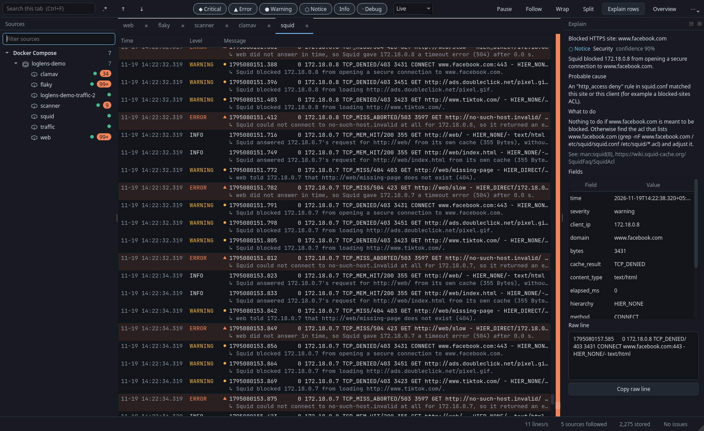
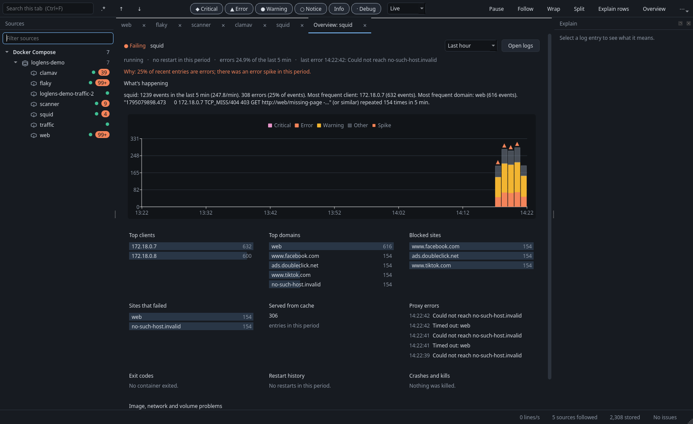
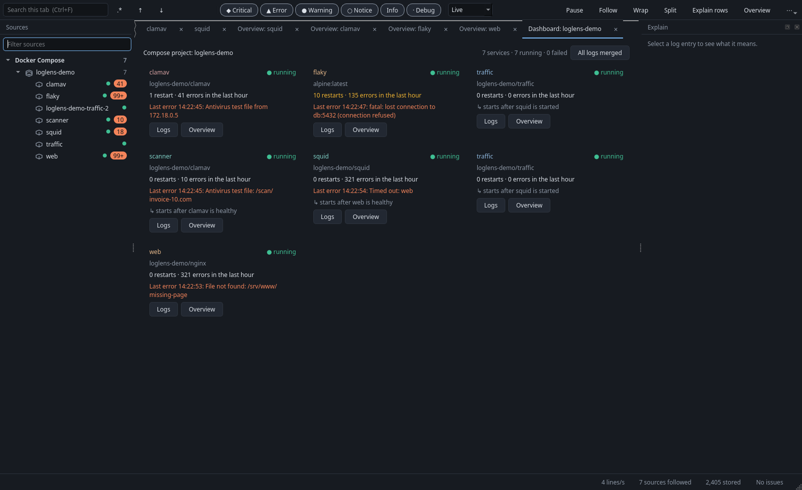

# LogLens

**See every log on your Linux machine, and what it means.**

LogLens finds the logs on your computer (systemd services, Docker containers and Compose
projects, and log files such as Squid, ClamAV, nginx and `auth.log`). It shows each
service's logs live and on their own, and explains in plain language what is happening:

> **Blocked HTTPS site: www.facebook.com.** Squid blocked 172.18.0.6 from opening a
> secure connection to www.facebook.com. *Probable cause:* an `http_access deny` rule
> matched. *What to do:* `grep -nF www.facebook.com /etc/squid/squid.conf /etc/squid/*.acl`



| | |
|---|---|
|  |  |
| Per-service overview: health, error spikes, top clients and domains | Docker Compose project dashboard |

## What it does

- **Finds sources automatically:** systemd units (journald), Docker containers, Compose
  projects grouped by project, and well-known log files.
- **Live, per-service logs:** filter by severity and time, full-text or regex search. It
  stays smooth with millions of lines.
- **Explanations:** 224 tested rules in 8 packs (Squid, ClamAV, Docker, Compose, sshd,
  nginx, systemd, kernel). Each gives a severity, the probable cause and a next
  step. No AI and no network. You can write your own rules, or create one from a line in
  the app.
- **What is happening now:** event rate, error spikes, top clients and domains,
  restarts and health per service, and a dashboard for each Compose project.
- **Private and safe:** everything stays on your computer, and passwords, tokens, keys
  and card numbers are removed before logs are stored. It never needs root; log text is
  treated as hostile input. See [docs/THREAT_MODEL.md](docs/THREAT_MODEL.md).

## Install

**Debian, Ubuntu, Kali, Parrot, Mint and other Debian-family systems** (x86-64):

```sh
sudo apt install ./loglens_0.1.0_amd64.deb
```

The package brings its own Python and Qt under `/opt/loglens`, so it works on Debian 12+
and Ubuntu 22.04+ whatever their Python version is. Start **LogLens** from your
applications menu, or run `loglens`.

**Any distribution:** download `LogLens-0.1.0-x86_64.AppImage`, then
`chmod +x LogLens-0.1.0-x86_64.AppImage && ./LogLens-0.1.0-x86_64.AppImage`.

**From source** (Python 3.12+, [uv](https://docs.astral.sh/uv/)):

```sh
git clone <this repository> && cd loglens
uv sync
uv run loglens
```

## Quick start

1. **First run:** a short guide shows what LogLens can read, with the exact command to
   fix anything it cannot, and lets you choose what to monitor. You can open it again from
   ⋯ > Getting started.
2. **Pick a service** on the left (or press Ctrl+K and type its name) to see its logs live.
3. **Select a line** and press Ctrl+E: the Explain panel says what it means.
4. **Double-click a service** for its overview, or a Compose project for its dashboard.

Want to see it with interesting logs first? Run `loglens --demo` to replay sample
Squid, ClamAV, nginx, sshd and Docker logs. Or start the demo Compose stack described in
[docs/DEMO.md](docs/DEMO.md).

## Permissions

LogLens runs as you and refuses to run as root. To read everything:

| To read | Run, then log out and back in |
|---|---|
| All system services (journal) | `sudo usermod -aG systemd-journal $USER` |
| A log file in /var/log | `sudo setfacl -m u:$USER:r FILE` (the app shows the exact command, including a rule that survives log rotation) |
| Docker containers | `sudo usermod -aG docker $USER`. **Warning:** the `docker` group is root-equivalent. Prefer rootless Docker. |

You can't or don't want to change groups? An administrator can enable the read-only
`loglens-helper` service, which streams only the logs they list. See
[docs/SECURITY.md](docs/SECURITY.md) and [docs/TROUBLESHOOTING.md](docs/TROUBLESHOOTING.md).

## Command line

```sh
loglens-cli sources                     # what LogLens found, and what limits it
loglens-cli tail systemd:ssh.service -f # follow a source (secrets redacted)
loglens-cli explain --file /var/log/squid/access.log --source squid
loglens-cli rules test                  # check rule packs, including your own
```

## Documentation

- [User guide](docs/USER_GUIDE.md), [Troubleshooting](docs/TROUBLESHOOTING.md),
  [Writing rules](docs/WRITING_RULES.md)
- [Security and privileges](docs/SECURITY.md), [Threat model](docs/THREAT_MODEL.md)
- [Architecture](docs/ARCHITECTURE.md), [Performance](docs/PERFORMANCE.md),
  [Contributing](CONTRIBUTING.md), [Changelog](CHANGELOG.md), [Roadmap](docs/ROADMAP.md)

## License

MIT. The packages bundle CPython (PSF license) and Qt for Python / Qt (LGPLv3).
