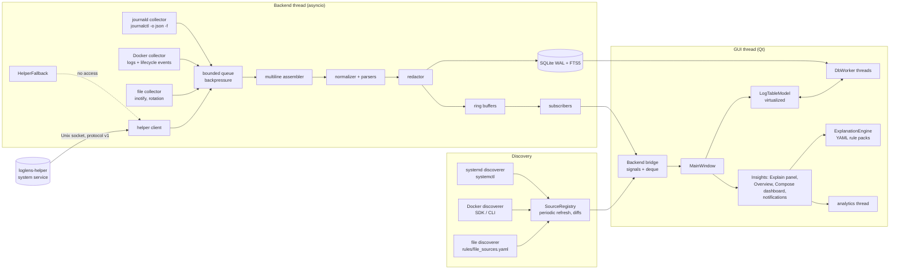

# Architecture

LogLens is a single-user desktop application written in Python 3.12 and PySide6 (Qt 6).
Collectors run on an asyncio loop in a background thread. Storage is SQLite (WAL, FTS5).
The GUI never blocks on I/O: it reads through worker threads and receives live entries
in batches.

## Components



## Data flow

1. **Discovery** (`collectors/discovery/`) lists sources and groups them into
   `ServiceGroup`s: the systemd units, each Compose project, standalone containers, and
   each file group. A discoverer never raises. It returns `DiscoveryIssue`s with an exact
   fix (`security/privileges.py` adds the journal-access check). `core/registry.py`
   refreshes every `discovery_interval_s` and emits only the differences.
2. **Collectors** (`collectors/`) stream `RawRecord`s, each with a resume cursor:
   journald `__CURSOR`, Docker `<ts_ns>:<n>`, file `<dev>:<ino>:<offset>`. Restarts
   resume without gaps or duplicates. `HelperFallback` switches a journal or file source
   to `loglens-helper` when the user cannot read it and the helper is installed.
3. **The pipeline** (`core/pipeline.py`) runs one task per source and a single writer.
   Records pass through a bounded queue (a slow writer slows collectors instead of using
   memory), the multiline assembler (stack traces become one entry), the normalizer
   (`parsers/`: the parser is chosen per source, timestamps become UTC, severity is
   inferred), and the **redactor** (`security/redact.py`). Then the batch is written
   with its cursors in one transaction, pushed to per-source ring buffers, and handed to
   subscribers.
4. **Storage** (`storage/sqlite.py`) is one database file (0600) in WAL mode. Readers run
   while the writer writes. FTS5 indexes messages, and covering indexes let the GUI page
   a filtered view by id. Retention, a disk budget and *Clear all data* live here.
5. **The GUI** (`gui/`) gets live entries from the backend thread through a deque that
   is drained every 100 ms, and discovery and stats through Qt signals.
   `LogTableModel` keeps only ids and severities per row and loads pages of entries on
   `DbWorker` threads, so a view stays smooth with millions of rows.
6. **Explanations** (`explain/`) are computed on demand for visible rows, the Explain
   panel and analytics. The analytics thread builds overviews, Compose dashboards and
   notification decisions without touching the reader used for scrolling.

## Core data model (`core/models.py`)

All frozen dataclasses:

| Type | What it is |
|---|---|
| `LogSource` | One stream: `id` (`systemd:ssh.service`, `docker:web-1`, `file:/var/log/auth.log`), `kind` (`SourceKind`), `display_name`, `group_id`, `status`, `metadata` |
| `ServiceGroup` | Sources shown together: `id`, `name`, `kind` (`GroupKind`: system, docker_compose, docker_standalone, files), `sources` |
| `RawRecord` | A line as a collector produced it: message, optional timestamp and severity, collector `fields`, `cursor` |
| `LogEntry` | A stored entry: storage-assigned `id`, `source_id`, UTC `timestamp`, `Severity`, `message`, `raw`, parsed `fields` |
| `Severity` | TRACE < DEBUG < INFO < NOTICE < WARNING < ERROR < CRITICAL (an `IntEnum`, comparable) |
| `Explanation` | `title`, `plain_text`, `severity_assessment`, `category`, `rule_id`, `confidence`, `probable_cause`, `suggested_action`, `references`, `tags`, `extracted` |
| `DiscoveryIssue` | Why something could not be discovered, phrased for the user, with a `hint` |

Collector fields always win over fields parsed from log text. `stream`, `parser`,
`truncated`, `lines`, `timestamp_source` and `redacted` are reserved: log text can never
set them. The Docker lifecycle rules depend on that (`stream: events`).

## Threads

| Thread | Runs |
|---|---|
| GUI | Qt event loop, models, widgets |
| `loglens-backend` | asyncio loop: discovery, collectors, pipeline, storage writes, retention |
| `loglens-db-reader` (DbWorker) | page and id queries for log views |
| `loglens-analytics` (DbWorker) | overviews, dashboards, notification checks |
| `loglens-rules` | loads rule packs once at startup (the first frame does not wait) |

## Extension points

- **Rule packs** (YAML, [WRITING_RULES.md](WRITING_RULES.md)): match by regex or fields,
  extract values, render templates. Overview cards and notification tags come from the
  pack too. Built-in packs live in `rules/`; user packs in `~/.config/loglens/rules/`
  or any folder listed in Settings. Packs from those folders are untrusted: their regexes
  time out, and their templates are limited to a whitelist.
- **File catalog** (`rules/file_sources.yaml`): which well-known log files to look for.
- **Parsers** (`parsers/`): a `Parser` turns a line into fields, a timestamp and a
  severity. The registry (`parsers/__init__.py`) picks one by source and priority.
- **Collectors** (`collectors/base.py` `Collector` protocol): one per `SourceKind`
  (`collectors.default_collectors()`).
- **Discoverers** (`collectors/discovery/base.py` `Discoverer` protocol).
- **loglens-helper protocol** (`helper/protocol.py`): versioned, line-delimited JSON over
  a Unix socket.

A stable plugin API for third-party collectors and parsers is on the
[roadmap](ROADMAP.md). Until then these are internal interfaces that may change.

## Layout

```
src/loglens/
  core/        models, registry, pipeline
  collectors/  journald, Docker, files; discovery/
  parsers/     Squid, ClamAV, nginx, sshd, dockerd, generic formats; multiline; normalizer
  explain/     rule loader + schema, engine, examples runner, insights, overview, editor
  storage/     SQLite storage, queries, retention
  security/    redaction, hostile-text sanitizing, privilege checks
  helper/      loglens-helper protocol, server, client
  gui/         Qt application
  resources.py data files (rules, demo logs, icons) inside the package or the checkout
rules/         built-in rule packs and the file catalog
packaging/     .deb, AppImage, Flatpak draft, desktop files, helper units, QA scripts
tests/         unit, GUI (offscreen), property/fuzz, acceptance, integration, perf
tools/         perf.py
```
