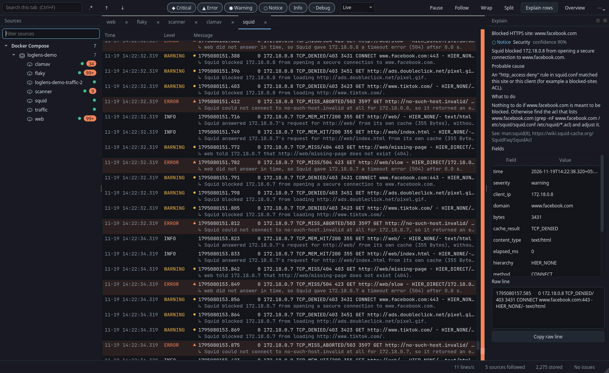
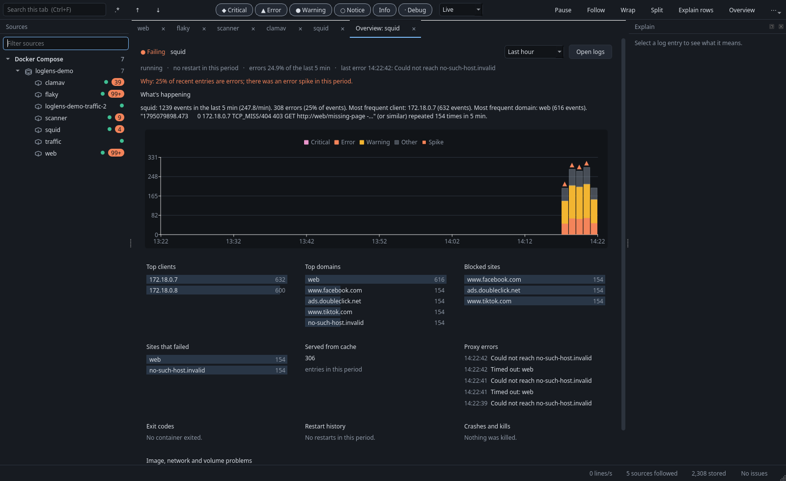
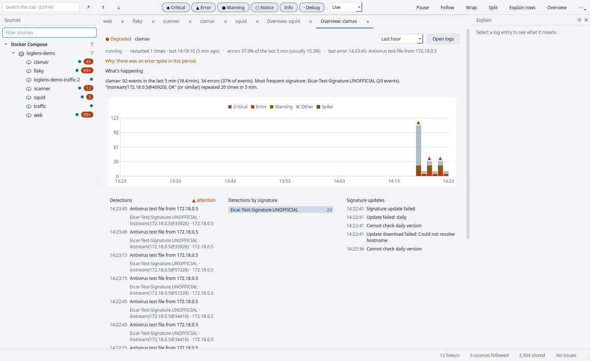
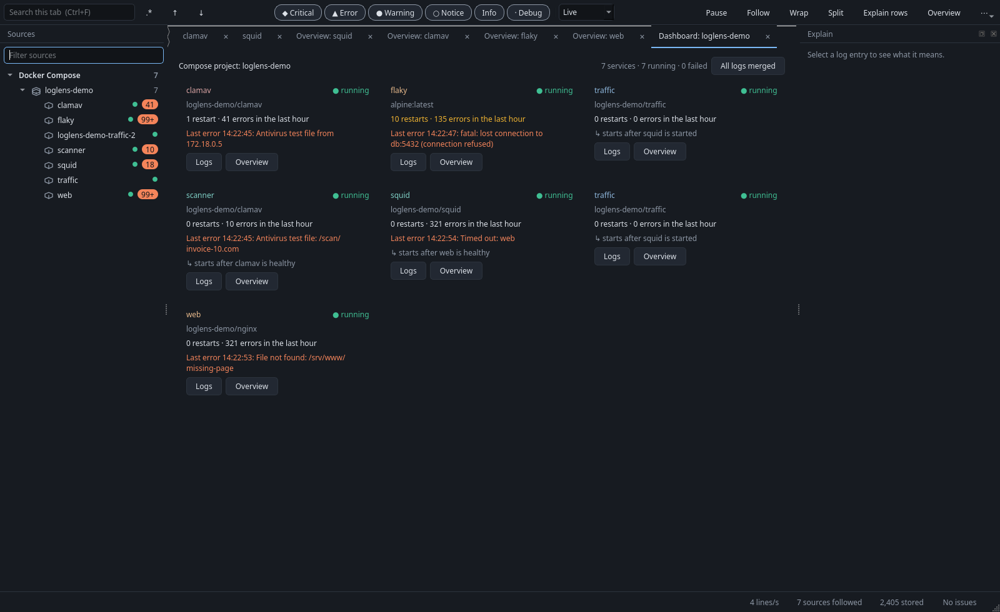
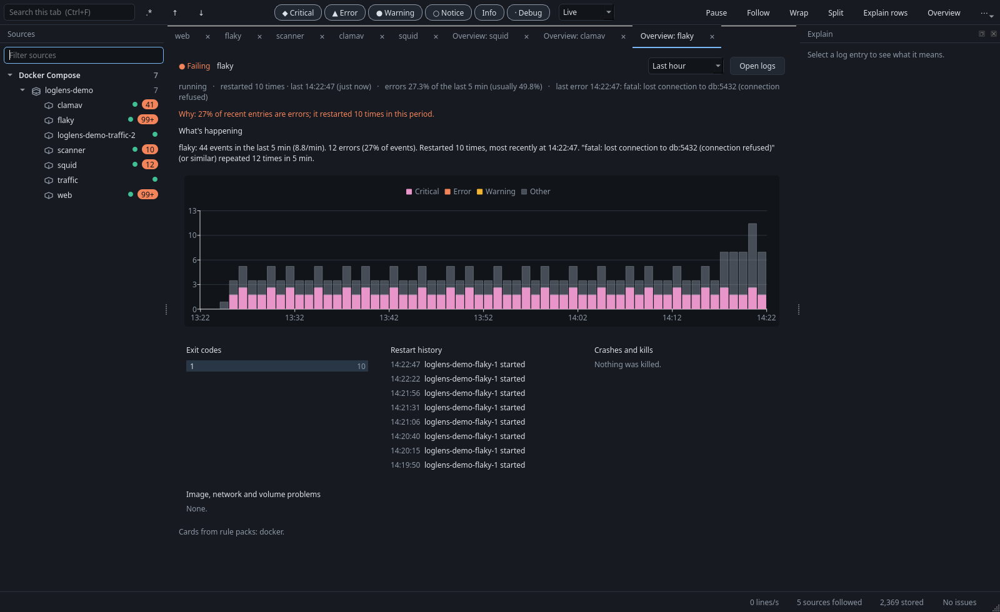
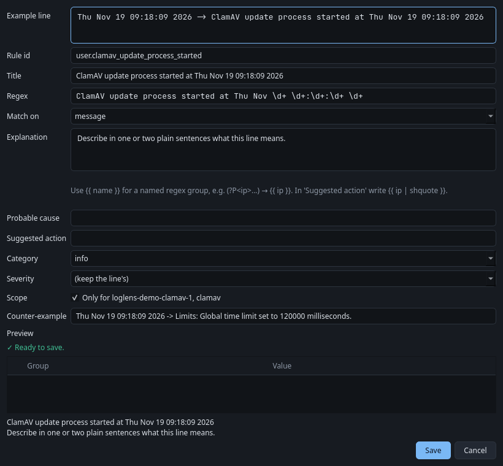

# Demo: Squid + ClamAV + a Compose project

A small Compose stack that produces the kind of logs LogLens is built to explain, so you
can see the Overview, Explain and Dashboard views describe real events. It builds from
`alpine` and runs **offline**: no image registry except Alpine's package mirror (once, at
build time), and no virus database download.

| Service | What it does | What LogLens should say |
|---|---|---|
| `web` | nginx with a `/health` check; `/slow` answers 504, missing pages 404 | page not found, backend too slow |
| `squid` | proxy with a `blocked_sites` ACL (`.facebook.com`, `.tiktok.com`, `.doubleclick.net`) | "Squid blocked 172.18.0.6 from opening a secure connection to www.facebook.com" |
| `traffic` ×2 | `curl` through the proxy: normal pages, a 404, blocked sites, a host that does not exist | two clients, blocked sites, "Could not reach no-such-host.invalid" (DNS failure) |
| `clamav` | `clamd` with a one-line signature for the EICAR test string; `freshclam` pointed at a mirror that does not exist | "A file that 172.18.0.7 sent for scanning is the EICAR test file. It is harmless…", update failures with "Could not resolve hostname" |
| `scanner` | every 30 s: a clean file and an EICAR file, scanned through clamd | detection card, scan summaries |
| `flaky` | crashes with exit code 1 after 25 s (`restart: always`) | exit codes card (1), restart history, restart-loop notification |

The **EICAR test string** is a harmless file that every antivirus detects on purpose, to
prove it works. ClamAV ships a full signature database of ~300 MB; the demo instead gives
clamd a single custom signature for EICAR (`demo/clamav/eicar.ndb`). That is why ClamAV
calls it `Eicar-Test-Signature.UNOFFICIAL`, and why LogLens says it is a test file rather
than malware.

## Run it

```sh
docker compose -f demo/docker-compose.yml -p loglens-demo up -d --build
uv run loglens            # the stack appears under Docker Compose > loglens-demo
```

Give it a minute. Then:

1. **Squid logs, Explain panel.** Click `squid`. Select a `TCP_DENIED/403 … CONNECT
   www.facebook.com:443` row. The Explain panel (right; Ctrl+E) reads
   *Blocked HTTPS site: www.facebook.com*. It says Squid blocked 172.18.0.6, gives the
   probable cause (an `http_access deny` rule matched), what to do (find the ACL with
   `grep -nF www.facebook.com /etc/squid/squid.conf /etc/squid/*.acl`), and lists the
   extracted fields and the raw line. A `TCP_MISS_ABORTED/503 … no-such-host.invalid` row
   reads *Could not reach no-such-host.invalid* (a DNS failure), not "client gave up".
2. **Inline explanations.** Toolbar **Explain rows** (density in ⋯ > Explanations under
   rows): each explained row gets a muted plain-language line.
3. **Squid Overview.** Double-click `squid` (or Ctrl+O on its tab). The header says how
   healthy it is and why (about a quarter of the entries are errors, because of the DNS
   failures and 504s). The paragraph names the busiest client and domain. Cards: top
   clients (two, the `traffic` replicas), top domains, **Blocked sites** (facebook, tiktok,
   doubleclick), **Sites that failed** (`no-such-host.invalid`), cache hits, proxy errors.
   Click a timeline bar to open the logs of just that minute.
4. **ClamAV Overview.** Double-click `clamav`: the **Detections** card (marked
   *attention*) lists *Antivirus test file from 172.18.0.7* with the signature; **Signature
   updates** shows the failing freshclam runs; the header counts the update errors.
5. **flaky Overview.** **Exit codes** shows `1`, **Restart history** one restart every
   ~25 s, the header *restarted N times*. The restart events come from Docker itself
   (LogLens merges each container's lifecycle events into its log stream).
6. **Project dashboard.** Double-click `loglens-demo`: every service with status,
   restarts, errors in the last hour, last error and dependency hints (`squid` *starts
   after web is healthy*, `scanner` *starts after clamav is healthy*). Click **Logs** or
   **Overview** on a tile.
7. **Notifications.** With the defaults (Settings > Desktop notifications), the EICAR
   detection and `flaky`'s restart loop raise desktop notifications through `notify-send`,
   at most one per service and condition per minute. Right-click a source > *Mute
   notifications* to silence it.
8. **A rule for an unexplained line.** Open `clamav` and select a line nothing explains
   (e.g. *Limits: File size limit set to 104857600 bytes.*). The Explain panel says so and
   offers **Create rule from this line**. The editor pre-fills a regex (numbers and IPs
   generalized), shows the regex groups and the rendered explanation live, and needs a
   counter-example (pre-filled from a neighbouring line). **Save** writes
   `~/.config/loglens/rules/user.yaml` after the whole pack passes the same checks as
   `loglens-cli rules test`; the line is explained immediately.
9. **Export / incident report.** Select some rows: ⋯ > *Copy incident report* puts
   Markdown with each entry, its explanation, cause, next step and raw line on the
   clipboard; ⋯ > *Export…* writes the view, the selection or a time range as .txt, .json
   or .csv.

Stop it with:

```sh
docker compose -f demo/docker-compose.yml -p loglens-demo down -v
```

## Screenshots

Rendered offscreen from the running stack by
`python -m loglens.gui.screenshots --stack docs/screenshots` (it discovers only the
`loglens-demo` project, so no other services on the machine appear):

| | |
|---|---|
|  |  |
| Explain panel + inline explanations | Squid Overview |
|  |  |
| ClamAV Overview (detections) | Compose dashboard |
|  |  |
| Exit codes and restart history | Rule editor with live preview |

## What the demo found (and fixed) in LogLens

Running real Squid 7, ClamAV 1.4 and nginx exposed gaps the fixture logs did not:

* Squid logs a DNS failure as `TCP_MISS_ABORTED/503 … HIER_NONE`; the "client gave up"
  rule claimed it first. The DNS rule now runs first.
* ClamAV 1.4 puts the level before the time (`ERROR: Thu Nov 19 … -> …`); the parser now
  reads that form, and new rules explain *Could not resolve hostname* and
  *Failed to get … version information*.
* Scans streamed to clamd are reported as `instream(172.18.0.7@33516): … FOUND`; new rules
  name the client instead of a pseudo file name.
* Times written inside containers are naive UTC; the host is UTC+5. Container entries
  now use Docker's own per-line timestamp.
* Squid cannot open `/dev/stdout` as its unprivileged user (`FATAL: Cannot open
  '/dev/stdout' for writing`, which LogLens explains); the demo logs to files instead.
* LogLens picks the nginx/Squid/ClamAV parser for a container by its image or service
  name, which is why the demo images are named `loglens-demo/nginx` etc. Recognising
  formats by content is a planned improvement.
