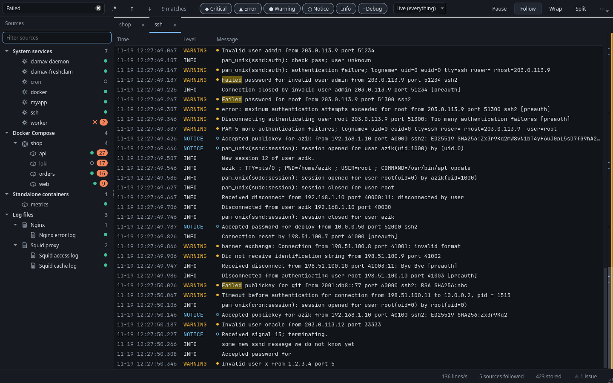
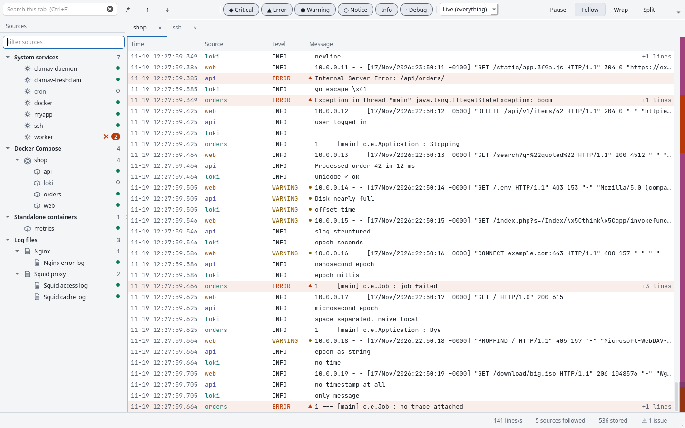

# LogLens GUI (Phase 5)

`loglens` starts the desktop app; `loglens --demo` replays sample logs through the real
pipeline (no Docker or root needed). Screenshots in [`screenshots/`](screenshots/) are
rendered offscreen from demo data with
`QT_QPA_PLATFORM=offscreen python -m loglens.gui.screenshots docs/screenshots`.

| | |
|---|---|
|  |  |
| Search highlights, severity rail, unread badges | Compose project merged, one color per service |

## Pages

A navigation bar on the left switches between six pages (design:
[`design/loglens-dashboard.figcraft`](design/loglens-dashboard.figcraft), dark and light).
LogLens opens on **Overview**.

| Page | Shows | Data |
|---|---|---|
| Overview | events per minute, errors in 24 h, sources followed, healthy services; event rate per hour; entries by source kind; errors per day; latest explanations (click: open logs). *Copy summary* puts it on the clipboard as Markdown, redacted again | `dashboard.model.build_dashboard` |
| Timeline | the stacked severity chart with spike markers (15 min, 1 h, 6 h or 24 h; click a bar: logs of that interval), notable moments (warnings, restarts, detections, spikes), busiest sources | same job |
| Sources | the log workspace described below: tree, tabs, toolbar, Explain panel | |
| Access | who LogLens runs as, journal/Docker/file/secret permissions, and each discovery issue with its fix and a Copy button (never run for you) | discovery issues, `security.privileges` |
| Alerts | notification conditions as switches, muted sources (Unmute), notifications sent this session, *Send a test alert* | `NotificationCenter`, `LiveExplainer` |
| Settings | every setting in cards, *Save* applies and writes config.toml; *Clear all data* | `SettingsFields` (shared with the dialog) |

The header search on Overview and Timeline opens every followed source in one tab with the
words highlighted. The Overview and Timeline numbers come from one job on the analytics
thread (exact SQL counts plus the newest 400 notable entries, explained by the rule packs).
It runs only while one of those pages is visible, at most every 5 s, and not before the
first discovery result (the backend has created the database by then).

## Layout (Sources page)

* **Sources** (left dock): System services / Docker Compose (project → services) /
  Standalone containers / Log files (group → files). Each row: kind icon, status shape
  (filled dot running, ring stopped, cross failed), unread-error badge, pin mark. Filter
  box on top. Context menu: Open, Open in new tab, Pin (follow in background), Copy ID,
  Look for new sources now. Click opens (or focuses) the source's tab; a Compose project or
  file group opens one merged tab.
* **Tabs** (center): one per source or group. Group tabs show every service merged, the
  service name in a stable per-service color; **Split** shows one pane per service.
* **Toolbar**: search (FTS5 prefix words, or `.*` regex), previous/next match and count,
  severity chips, time range (Live, 5 min, 1 h, 24 h, custom), Pause, Follow, Wrap, Split.
  Filters belong to the tab: switching tabs shows that tab's filters; they persist in
  `~/.local/state/loglens/session.json` with the open tabs.
* **Status bar**: pipeline lines/s, followed sources, stored entries, issues button.
* **Discovery issues** (bottom dock): each `DiscoveryIssue` and collector error with its
  "How to fix" text.
* **Settings** (Ctrl+,): theme, retention, extra rule-pack folders, hidden-source patterns,
  discovery interval; saved to `~/.config/loglens/config.toml` (0600, atomic write).

## Design system

One token table per theme (`gui/theme.py`) drives the QPalette, the single stylesheet and
everything custom-painted. Dark: graphite `#111418` / `#171B21` / `#222832`, steel-blue
accent `#7AB8F5`. Light: white canvas, `#F4F5F7` panels, `#1E66B0` accent. Follows the
desktop color scheme by default (and live, when it changes).

Severity is the product's signal, so it carries the identity: Okabe-Ito colorblind-safe
hues (vermilion error, orange warning, reddish-purple critical, sky-blue notice), each
paired with a **shape** in the row's rail (◆ critical, ▲ error, ● warning, ○ notice) and
the same shapes on the filter chips, so color is never the only cue. Every text color
meets WCAG 4.5:1 on both backgrounds in both themes (tested).

The signature element is the **severity map**: the strip beside the scrollbar compresses
the whole tab (a million rows) into its height. Errors and criticals are full-width
marks, warnings a thin edge, search hits ticks on the left, and the visible window a
frame. Click or drag to jump.

## Threads and data flow

```
asyncio thread (Backend)                         GUI thread
  discovery every N s ── sourcesChanged ───────▶  SourceTreeModel.update
  IngestPipeline ── stored batch ─▶ deque ──(100 ms drain timer)──▶ every tab's model
  stats every 1 s ──── statsChanged ───────────▶  status bar
reader thread (DbWorker, own SQLite connection)
  entry_ids(query) / entries_by_id(page) / timed regex ◀── submit ── LogTableModel
                                                ── done (queued signal) ──▶
```

The GUI thread never touches SQLite or a subprocess. GUI → backend calls
(`follow`, `unfollow`, `refresh_discovery`) are `call_soon_threadsafe` and return at once.
Entries arrive at tens of thousands per second, so they go through a deque drained once per
100 ms tick (one model update per tick, not one signal per batch). The window is built and
connected before the backend starts, so the first discovery result is never lost.

## The log view

`LogTableModel` (a `QAbstractTableModel`) holds two arrays per tab: entry ids (ascending)
and severities (9 bytes per row). They come from one background query on the covering index
`entries(source, id, severity, ts)`. Entries are fetched 256 rows at a time, on demand, into
a 20k-entry LRU cache. Until a page arrives the row shows a placeholder, but its severity
(row tint, rail, map) is already known. Live entries are filtered with the tab's query
(`EntryQuery.accepts`) and appended at the end. Ids only grow, so appends never move
existing rows, and anything the initial query already returned is ignored by id.

The view is a `QTableView`, not a `QTreeView`. At 1M rows QTreeView relays out every row
on each insert (775 ms per 400-row append, measured), while QTableView takes about 6 ms.
Row heights live in the vertical header: expanded multi-line entries (double-click, Enter
or the menu) and wrapped rows resize only themselves. Wrap measures just the rows on
screen, again whenever you scroll or resize.

Other details:

* Follow-bottom turns off when you scroll up or jump to a match, and back on at the
  bottom or with End.
* Pause holds live entries (up to 200k, then the tab reloads on resume).
* Copy (Ctrl+C or menu) exports the selection as text or JSON, fetching unloaded rows in
  the background.
* A row that retention deleted shows "no longer stored" instead of loading forever.

## Search

Plain search is FTS5: every word must match as a prefix (`fail` finds "Failed"), and
quotes and FTS syntax are neutralized. Regex search uses the `regex` module as an SQLite
function with three safeguards:

* a 50 ms timeout per line (catastrophic backtracking stops instead of hanging);
* a 10 s total budget, enforced by a progress handler;
* `concurrent=True`, so matching releases the GIL and the GUI keeps painting.

Search highlights matches rather than filtering. Live entries are matched as they arrive,
and highlighting uses a 5 ms per-line timeout.

## Keyboard

| Keys | Action |
|---|---|
| Ctrl+K | Jump to any source (fuzzy: `cld` finds clamav-daemon) |
| Ctrl+F, Enter / F3, Shift+F3 | Search, next match, previous match |
| Ctrl+P | Pause / resume live updates |
| Ctrl+1 … Ctrl+9, Ctrl+W | Switch to tab N, close tab |
| Enter / double-click | Expand or collapse a multi-line entry |
| Ctrl+C | Copy selected entries |
| Ctrl+Shift+1 … Ctrl+Shift+5 | Overview, Timeline, Sources, Access, Alerts |
| Ctrl+, | Settings page |
| Ctrl+Alt+D | Debug overlay: frame time, rows/s, pages/s, drain time, backlog |

Every interactive widget has an accessible name; tab order follows the visual order.

## Measurements

Laptop (Kali, Python 3.13, PySide6 6.12), offscreen. Reproduce with
`uv run pytest tests/test_gui_stress.py -s`. "Frame interval" is how often a 16 ms timer
actually fires, so 16 ms is perfect and anything higher is an event-loop stall.

**20,000 lines/s into one tab**, real pipeline (assembler, parsers, SQLite with FTS),
while the user scrolls:

| | |
|---|---|
| Pipeline ingest | 19,973 lines/s |
| Rows shown in the tab | 20,004 rows/s (122,000 rows in 6.1 s) |
| GUI frame interval | avg 19.3 ms, p99 39.9 ms, max 44.0 ms |
| Drain per 100 ms tick | avg 3.2 ms, max 8.4 ms |

**One tab over 1,000,000 stored entries**:

| | |
|---|---|
| Id list load (background) | 0.33 s |
| Jump anywhere → rows painted | avg 40 ms, max 45 ms |
| GUI frame interval while scrolling | avg 16.0 ms, p99 25.3 ms, max 26.5 ms |

**Storage at 1M rows**: one source's id list 0.10 s; three sources merged 0.40 s; one page
of 256 entries 1.2 ms.

**Real machine** (systemd + Docker): all 153 discovered sources (after the default
`*.scope` / `user@*` filters) appear in the tree, in all four categories, with both Compose
projects grouped (5 and 3 services). Opening NetworkManager, journald and a stopped
Compose container loaded 499, 6 and 112 entries and kept following them.

# Phase 6: explaining what is happening

Walkthrough with the demo stack: [DEMO.md](DEMO.md).

* **Explain panel** (right dock, Ctrl+E): for the selected entry, the title, plain-language
  text, severity and category chips, confidence, probable cause, what to do, references, the
  extracted values and parsed fields as a table, and the raw line (copyable). If no rule
  matched, it says so (LogLens never guesses) and offers **Create rule from this line**.
* **Inline explanations** (toolbar *Explain rows*; density in ⋯): *compact* adds the title
  after the line, *full* adds a muted second line under explained rows. Explanations are
  computed only for rows being painted (and cached), so a million-row tab costs nothing
  extra until you scroll.
* **Service Overview** (double-click a source, Ctrl+O on a tab, or the context menu):
  * a health header: state word and why, status, restarts and the last one, error rate
    now vs. usual, last error;
  * a "What's happening" paragraph from the insight engine;
  * a timeline of events per bucket stacked by severity, with spike markers. Click a bar
    to open the logs of that interval;
  * cards declared by the rule packs. The period can be 15 min, 1 h, 6 h or 24 h.
* **Compose dashboard** (double-click a Compose project): one tile per service with status,
  image, restarts, errors in the last hour, last error and dependency hints (from Compose's
  `depends_on` label and from dependency rules). Tiles open the service's logs or Overview.
* **Notifications**: freedesktop notifications through `notify-send` for the conditions
  chosen in Settings:
  * a critical entry;
  * a detection (rules tagged `detection`);
  * a restart loop (rules tagged `restart_loop`, or 3 restarts in 5 minutes).

  Mutes are per source (context menu). Limits are one notification per source and
  condition per minute and 5 per minute overall, and suppressed ones are counted in the
  next. Log text is passed after `--`, so it can never be read as a `notify-send` option.
* **Rule editor**: drafts a rule from the selected line. Numbers and IPs are generalized
  and IPs captured as `ip`, the rule is scoped to the line's service, and a neighbouring
  line is suggested as the counter-example. It previews the regex groups and the rendered
  explanation live, through the real schema validator, compiler and sandbox. Saving
  rewrites `~/.config/loglens/rules/user.yaml` only after the whole user pack, including
  the new rule's own examples, passes the checks of `loglens-cli rules test`.
* **Export and incident report**: ⋯ > *Export…* writes the view, the selection or a time
  range as .txt, .json (streamed) or .csv (spreadsheet formulas neutralized), on the reader
  thread. ⋯ > *Copy incident report* (Ctrl+Shift+C) puts Markdown on the clipboard: when,
  which sources, and each entry with its explanation, cause, next step and raw line.

## Threads

Overview pages, the Compose dashboard and the explanations behind notifications run on a
second worker thread ("analytics"), so a refresh never delays paging in the log views. Each
page refreshes at most once per second, and only when new entries arrived for its sources.
That thread has its own explanation engine and cache, so nothing mutable is shared across
threads.

A page loads its window from SQLite:

* the newest 20,000 entries feed the cards and the summary (the page says when it is
  sampled);
* an exact `GROUP BY` histogram feeds the timeline, however busy the source is.

## Overview cards in rule packs

Cards and thresholds are data in the pack, never per-service GUI code:

```yaml
overview:
  applies_to: {services: ["*"]}       # optional: which sources show these cards
  key_fields: {client_ip: client, domain: domain}   # named in "What's happening"
  thresholds: {error_rate: 0.10, spike_z: 3, spike_min_errors: 5}
  cards:
    - {title: Top clients, kind: top, field: client_ip}
    - {title: Blocked sites, kind: top, field: domain, when: {tags: [denial]},
       empty: Nothing was blocked.}
    - {title: Served from cache, kind: count, when: {tags: [cache_hit]}}
    - {title: Detections, kind: recent, when: {tags: [detection]},
       columns: [signature, file, client], limit: 10, warn_at: 1}
```

* `top` counts the most frequent values of `field`, `count` counts entries, and `recent`
  lists the newest entries with `columns`.
* Fields come from the rule's extracted values first, then from the parsed fields.
* `when` selects entries by rule ids, tags and/or a minimum severity.
* `warn_at` marks the card as needing attention.
* A pack's cards appear when its own `applies_to` selects the source, when one of its
  rules explained an entry, or when `overview.applies_to` matches. Docker uses the last
  case to add lifecycle cards to every container.
* `rules lint` validates the block (with file and line) and reports cards that name
  unknown rules.

## Docker lifecycle events

Each container's stream now also carries its lifecycle events from the Docker events API
(`create`, `start`, `die` with the exit code, `kill`, `oom`, `stop`, `health_status`),
written in `docker events` text form. That is what lets the Docker rules explain exit
codes, OOM kills and restarts, and what feeds the restart-history and exit-code cards.

* Events carry no cursor, so the source's resume point stays the log position.
* On first follow, the last hour of events is read.
* Duplicates after reconnects are dropped by nanosecond timestamp.
