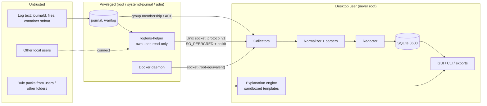

# LogLens threat model

LogLens reads every log on a machine and shows it to a desktop user. Logs are written by
programs that are not LogLens and often by remote parties: a web request, a container, a
proxied URL or an SSH login attempt all end up as text LogLens parses, stores, renders
and explains. **All log content is hostile input.** This document lists what we protect,
where trust changes, who the attackers are, and which mitigation answers each threat
(with the code and the test that hold it in place).

## Assets

| Asset | Why it matters |
|---|---|
| Secrets that appear in logs (passwords in URLs, tokens, API keys, cookies, card numbers, private keys) | Logs leak credentials all the time; LogLens must not become a second, searchable copy of them. |
| Log content itself | Reveals users, IPs, internal hosts and activity; readable today only by privileged groups. |
| The user's desktop session | A GUI that parses hostile text must not run code, open links or drive the terminal. |
| The machine's privilege boundary | Reading system logs needs privileges; LogLens must not turn that into root, or into access for other local users. |
| Integrity of explanations | Users act on "what is happening" summaries; an attacker must not forge Docker events, hide detections or inject commands into suggested actions. |
| Availability of the app | A log line must not crash, hang or exhaust memory or disk. |

## Trust boundaries

1. **Log text → LogLens.** Everything inside a message, field, file name or container
   label is attacker-controlled.
2. **Rule packs → engine.** Built-in packs ship with LogLens and are reviewed and tested.
   Packs from other folders, including the rule editor's `user.yaml`, are untrusted.
3. **User ↔ privileged data.** LogLens runs as the desktop user. System logs are reached
   through group membership, ACLs or the optional helper, never by running the GUI as
   root.
4. **Helper ↔ any local process.** The helper's socket accepts connections from anyone,
   and authorizes each peer itself.
5. **LogLens → outside.** No network by default. Exports, incident reports and the
   future AI explainer (Phase 8) are where data leaves on purpose.

## Attackers

| | Attacker | Can do | Wants |
|---|---|---|---|
| A1 | **Malicious log content**: a remote client, a crafted URL, a username in an SSH attempt, any program writing to a log | Put arbitrary bytes into one or many log lines, at high rate | Run code, drive the user's terminal, spoof a UI, hang or crash LogLens, plant misleading explanations, make secrets persist |
| A2 | **Malicious container**: a compromised or hostile image | Everything A1 can, through stdout/stderr, plus choosing its labels and name, and restarting at will | Forge Docker lifecycle events ("died", "OOM"), impersonate other services, flood the app |
| A3 | **Local unprivileged user**: another account on the machine | Connect to the helper socket, read world-readable files, race file operations in directories they own | Read logs they are not allowed to read, through LogLens or its helper |
| A4 | **Malicious rule pack**: shared online, or planted in a folder LogLens loads | Arbitrary YAML, regexes and templates | Execute code via YAML or Jinja, ReDoS the engine, put commands into "suggested action", hide detections |

## Threats and mitigations

| # | Threat | Attacker | Mitigation | Where | Test |
|---|---|---|---|---|---|
| T1 | Terminal escape / OSC 8 hyperlink / title injection when the CLI prints or a user `cat`s an export | A1, A2 | CSI/OSC/DCS sequences removed, C0/C1 controls → `?`, in CLI output, text/CSV exports and incident reports | `security/text.py` `printable`, `cli._safe`, `export.py` | `test_acceptance_security`, `test_fuzz_security::test_printable…`, `test_cli` |
| T2 | Bidi overrides ("Trojan Source"): text displays differently from what it is | A1 | Bidi controls (U+202A–E, U+2066–9, LRM/RLM/ALM) → `?` everywhere text is rendered | `security/text.py` | `test_acceptance_security` |
| T3 | Qt rich text: log text interpreted as HTML in labels and tooltips (images, links, layout spoofing) | A1 | Every log-derived label is `PlainText` (`SafeLabel`), tooltips go through `plain_tooltip`, desktop notification bodies are escaped | `gui/insight_widgets.py`, `gui/log_model.py`, `gui/notify.py` | `test_gui_phase6`, `test_gui_window` |
| T4 | Huge lines (10 MB+) exhaust memory or freeze the view | A1, A2 | Collectors cap lines at 64 KiB (`truncated`), journald JSON at 1 MiB, normalizer message at 64 KiB, rule regexes see 4 KiB, template values are clipped, rendered output 8 000 chars | collectors, `parsers/normalize.py`, `explain/rules.py` | `test_acceptance_security`, `test_parser_properties` |
| T5 | ReDoS via log text against built-in rules and parsers | A1 | Built-in regexes reviewed for backtracking (look-behind anchors), CI benchmarks crafted long lines in linear time | `rules/*.yaml`, `parsers/` | `test_parser_properties::test_crafted_long_lines…`, `test_explain_bench` |
| T6 | ReDoS through user-supplied regexes (rule packs, rule editor, search, custom redaction patterns) | A4, user error | Untrusted packs and the editor use the `regex` module with a 20 ms per-line timeout; a rule that times out 3× in 60 s is suspended for 60 s (never permanently, so log text cannot switch a detection off for good); search 50 ms per line and 10 s total; custom redaction patterns 5 ms | `explain/rules.py`, `explain/engine.py`, `explain/editor.py`, `storage/sqlite.py`, `security/redact.py` | `test_explain::test_user_pack_regex…`, `test_fuzz_security::test_custom_patterns_cannot_hang` |
| T7 | Jinja template injection: log text containing `{{ … }}` | A1 | Log values are only ever *data* in the context; templates come from packs, never from log text | `explain/rules.py` | `test_acceptance_security` (`{{ 7*191 }}` is never 1337) |
| T8 | Malicious templates in rule packs: sandbox escape, attribute access, loops, huge output | A4 | `ImmutableSandboxedEnvironment`, plus a load-time AST whitelist (no `For`, `Call`, `Getattr`, `Pow`, `Assign`, `Macro`), size-preserving filters only, string repetition capped at 10 000, list repetition refused, output cut at 8 000 chars, `StrictUndefined` | `explain/rules.py` `RuleSandbox`, `_template_violation` | `test_explain::test_hostile_rule_templates…`, `test_repetition…`, `test_size_multiplying_filters…` |
| T9 | Command injection through "suggested action" (admins copy-paste them) | A1, A4 | Every value in an `action` template must end in `\| shquote`, enforced at load time | `explain/rules.py` `_all_shell_quoted` | `test_explain` |
| T10 | Unsafe YAML (`!!python/object`) in rule packs and catalogs | A4 | `yaml.SafeLoader` only; JSON Schema validation of every pack | `explain/rules.py`, `collectors/discovery/files.py` | `test_explain` |
| T11 | Forged collector fields: a JSON log line claiming `stream: events`, `parser`, `container_id` … to fake Docker lifecycle events | A1, A2 | Collector fields override parser fields; `stream`, `parser`, `truncated`, `lines`, `timestamp_source`, `redacted` are reserved (parsers can never set them); lifecycle rules apply only to container sources and require `stream: events`, which only the Docker events API sets | `parsers/normalize.py`, `rules/docker.yaml` | `test_parsers::test_log_text_cannot_claim…`, `test_docker_collector` |
| T12 | Secrets persisted in the database, its WAL, FTS index, exports or reports | A1 (by accident or on purpose) | Redactor runs in the pipeline **before** storage, FTS and subscribers; runs again on every export and incident report; irreversible `[REDACTED:kind]` by default | `security/redact.py`, `core/pipeline.py`, `export.py` | `test_acceptance_security` (DB + WAL + exports), `test_fuzz_security` |
| T13 | A crafted line makes a keyed pattern swallow the next key and leave the secret (`password= passwd: x`) | A1 | Captured values may not themselves be keys | `security/redact.py` `_NOT_A_KEY` | `test_fuzz_security::test_planted_secrets_never_survive` (found by fuzzing) |
| T14 | Reveal vault leaks secrets | A3, backup theft | Off by default; owner-only files (0600, dir 0700); HMAC tokens, so no secret is derivable from a token; never used by exports or reports; "Clear all data" wipes it in memory and rotates the key | `security/redact.py` `SecretVault` | `test_privileges::test_vault_clear…` |
| T15 | Other local users read the database | A3 | DB, `-wal`, `-shm` 0600, data directory 0700 (permissions re-tightened at every open) | `storage/sqlite.py` | `test_storage` |
| T16 | Stolen disk or backup exposes logs | physical | Optional SQLCipher encryption (`LOGLENS_DB_KEY`, needs `sqlcipher3`; fails clearly if missing). Without it: use full-disk encryption. "Clear all data" uses `secure_delete`, `VACUUM` and WAL truncation | `storage/sqlite.py` | `test_storage` (`clear_all`) |
| T17 | Flood: memory or disk exhaustion | A1, A2 | Bounded queue (backpressure), bounded ring buffers, at most 5 M rows per view, memory governor sheds caches and the oldest loaded rows above the budget, disk budget deletes the oldest entries, collector cap; a banner tells the user what was dropped | `core/pipeline.py`, `gui/main_window.py`, `storage/sqlite.py` | `test_pipeline::test_backpressure…`, `test_gui_stress` |
| T18 | Running the GUI as root turns any parser bug into root code execution | all | The GUI refuses to start as root; discovery shows the exact least-privilege fix per source (`systemd-journal` group, ACLs with a default ACL, rootless Docker) | `gui/app.py`, `security/privileges.py`, discovery | `test_privileges` |
| T19 | `docker` group membership is root-equivalent | A2, A3 | The hint says so explicitly and offers rootless Docker or the helper | `security/privileges.py` | `test_privileges` |
| T20 | Helper: unauthorized local user reads logs | A3 | Peer identity from `SO_PEERCRED` (kernel, unforgeable); allowed if root, in `allow_groups`, or polkit grants `org.loglens.helper.read-logs` (subject `pid,start-time,uid`, so a recycled pid cannot borrow a grant) | `helper/server.py` | `test_helper::test_unauthorized…`, `test_peer_credentials…` |
| T21 | Helper: reading files outside the allowlist (paths, `..`, symlinks, resume cursors, FIFOs, symlinked directories, swaps after rotation) | A3 | Only sources in the root-owned config; files must be regular, reached by their real path, and match a pattern; strict opens use `O_NOFOLLOW` + `O_NONBLOCK`, verify `/proc/self/fd` equals the requested path, and repeat on every reopen; a cursor naming another inode starts fresh, with no directory search | `helper/server.py`, `collectors/files.py` (`strict=True`) | `test_helper::test_symlinks…`, `test_strict_file_collector…`, `test_strict_open_rejects…` |
| T22 | Helper: malformed or hostile protocol messages; oversized lines ending a stream | A3 / compromised helper | Versioned protocol, 64 KiB per message, unknown keys/types rejected both ways, records cut by encoded size (never refused), request timeout, client cap | `helper/protocol.py` | `test_helper::test_malformed…`, `test_fuzz_security::test_protocol…` |
| T23 | Helper compromise becomes root | A3 | Runs as its own user (not root, refuses root), no capabilities, `NoNewPrivileges`, no network, syscall filter, read-only filesystem, memory and task limits | `packaging/helper/loglens-helper.service` | review |
| T24 | Spreadsheet formula injection in CSV exports | A1 | Cells starting with `= + - @ \t \r` are prefixed with `'` | `export.py` | `test_phase6_logic` |
| T25 | Markdown injection in incident reports (closing the code fence, links) | A1 | Fence longer than any backtick run in the line; prose escaped | `export.py` | `test_phase6_logic` |

## Residual risks and accepted limitations

* **Redaction is pattern based.** A secret in a format none of the patterns knows, and
  without the shape of a high-entropy token, is stored. Users can add custom patterns.
  A secret split by the 64 KiB line cap may be stored partially.
* **High-entropy detection skips hex strings** (container ids, hashes) and key
  fingerprints after `SHA256:`. A hex-only secret is not caught by that rule.
* **Rule suspension is a trade-off.** A hostile line stream can keep a *user* pack rule
  that times out suspended, 60 s at a time. Built-in rules use `re` and are never
  suspended.
* **SQLCipher is optional.** Without `sqlcipher3`, encryption at rest relies on disk
  encryption.
* **The helper trusts its administrator's config.** Allowing `/var/log/*` allows
  everything there. Directories writable by a service account (for example
  `/var/log/squid` owned by `proxy`) are protected against symlink swaps but not
  against that account writing misleading logs: that is A1, by design.
* **Docker access is root-equivalent.** LogLens can only warn and offer alternatives.
  The helper does not proxy Docker in protocol v1.
* **Desktop notifications go through `notify-send`.** The body is escaped and capped,
  but what a notification daemon does with it is outside LogLens.
