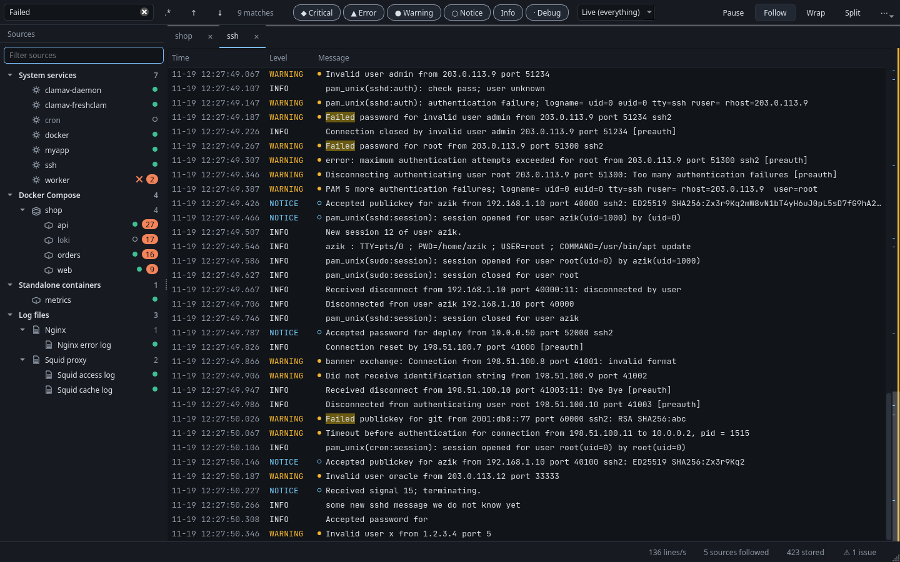
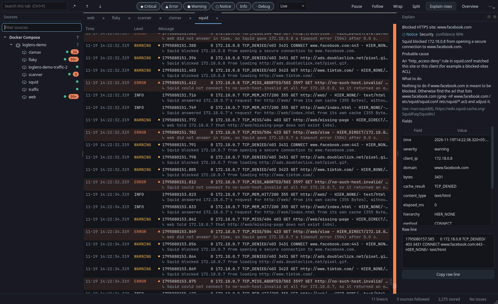
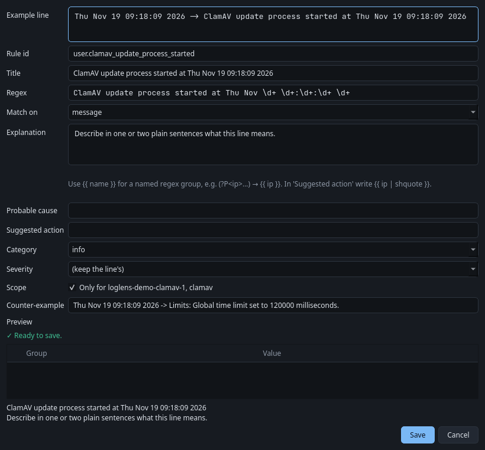
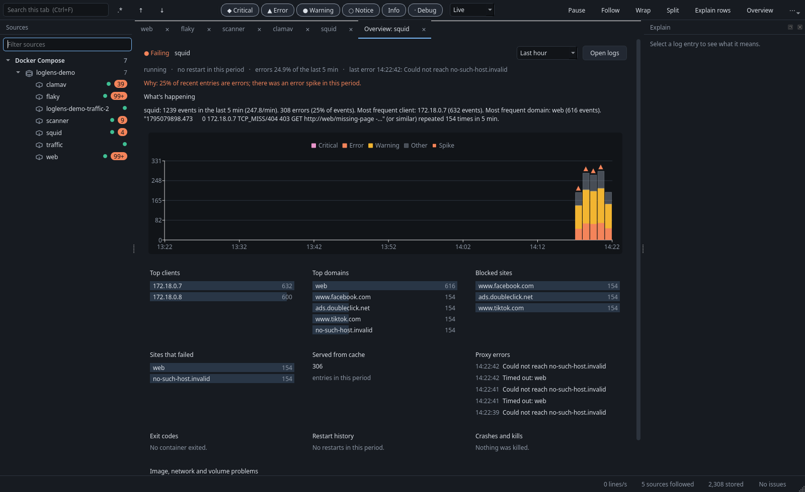
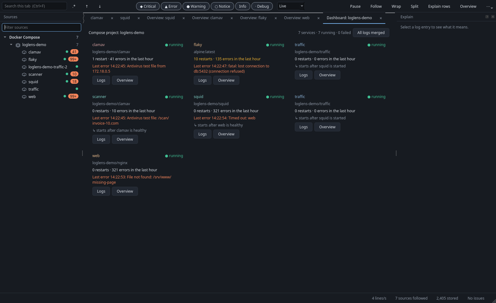

# LogLens user guide

LogLens finds the logs on your Linux machine: systemd services (journald), Docker
containers and Compose projects, and well-known log files such as Squid, ClamAV and nginx.
It shows each service's logs separately and live, and explains recognised lines in plain
language. It runs as your user, only reads, and keeps everything on your computer.

This guide is for people who installed the `.deb` package. When something does not work,
see [TROUBLESHOOTING.md](TROUBLESHOOTING.md).

Contents:

- [Install and uninstall](#install-and-uninstall)
- [First run](#first-run)
- [The window](#the-window)
- [Explanations](#explanations)
- [Overview and Compose dashboard](#overview-and-compose-dashboard)
- [Notifications](#notifications)
- [Export and incident reports](#export-and-incident-reports)
- [Settings reference](#settings-reference)
- [Privacy](#privacy)
- [Resource limits](#resource-limits)
- [Keyboard shortcuts](#keyboard-shortcuts)
- [Command-line tools](#command-line-tools)
- [Files and folders](#files-and-folders)

## Install and uninstall

The package works on Debian-family distributions (Debian 12+, Ubuntu 22.04+, Kali, Parrot,
Mint). It carries its own Python and Qt under `/opt/loglens`, so the Python version of
your distribution does not matter.

Install (or upgrade) with apt, so the required system libraries are installed too. Keep
the `./`, or apt looks for a package name instead of a file:

```sh
sudo apt install ./loglens_0.1.0_amd64.deb
```

This installs:

| Path | What it is |
|---|---|
| `/usr/bin/loglens` | The desktop app (also in your application menu as **LogLens**) |
| `/usr/bin/loglens-cli` | Command-line tool |
| `/usr/bin/loglens-helper` | Optional read-only helper service (disabled until an administrator enables it) |
| `/opt/loglens/` | Bundled Python, Qt and LogLens itself |
| `/etc/loglens/helper.toml` | Helper configuration |
| `/usr/lib/systemd/system/loglens-helper.{socket,service}` | Helper units |
| `/usr/share/doc/loglens/` | This guide and the other documents |

apt also suggests installing `libnotify-bin` (desktop notifications), `acl` (`setfacl`)
and polkit (helper password prompts). Install them if they are missing:

```sh
sudo apt install libnotify-bin acl
```

Uninstall:

```sh
sudo apt remove loglens     # removes the program, keeps /etc/loglens/helper.toml
sudo apt purge loglens      # also removes /etc/loglens/helper.toml
```

Removing the package does not touch your personal data (settings, stored logs, your
rules). To delete those too, see [Resetting LogLens](TROUBLESHOOTING.md#resetting-loglens).
The `loglens-helper` system user stays after a purge (Debian never reuses a uid).

## First run

Start **LogLens** from the application menu, or run `loglens` in a terminal. Do not use
`sudo`: LogLens refuses to run as root (see [Privacy](#privacy) for why).

The first time, a short guide opens on top of the window. It has four pages:

1. **Welcome**: what LogLens does.
2. **What LogLens can read**: one line each for system services, Docker, and log files,
   with how many sources were found. Where your account cannot read something, it shows
   the exact command that fixes it, with a **Copy** button. After you change a group
   membership, log out and back in, then use **⋯ > Look for new sources now**.
3. **Choose what to monitor**:
   - **Show**: untick a category to hide it from the source list (it adds `systemd:*`,
     `docker:*` or `file:*` to *Hide sources matching* in Settings).
   - **Follow in the background**: Compose projects and log-file groups with at most 25
     sources. Followed sources are read even without an open tab, so you get unread
     counts and notifications. Compose projects are ticked by default.
4. **Try it with sample logs** (optional):
   - **Open the replay demo** starts a second LogLens window (`loglens --demo`) that
     replays sample Squid, ClamAV, nginx, sshd and Docker logs. Nothing is installed.
   - **Start the demo stack** builds and starts real Squid, ClamAV and nginx containers
     as the Compose project `loglens-demo`. It needs Docker with Compose and access to
     Docker, and network access once to build. Stop it with
     `docker compose -p loglens-demo down -v`. [DEMO.md](DEMO.md) walks through it.

Finishing the guide saves your choices. Closing it with **Cancel** saves nothing except
that it was shown. The guide does not open again by itself; reopen it with
**⋯ > Getting started…**.

## The window



### Source list

The dock on the left lists every source in four categories:

- **System services**: systemd service units and their journal.
- **Docker Compose**: one entry per project (from the `com.docker.compose.project`
  label), with its services underneath.
- **Standalone containers**: containers that are not part of a Compose project.
- **Log files**: groups such as *Squid proxy*, *ClamAV antivirus*, *Nginx*,
  *Authentication*, *System log*, *Fail2ban* and *UFW firewall*.

Each row shows a kind icon, a status shape (filled dot running, ring stopped, cross
failed), an unread-error badge and a pin mark. The box at the top filters the list.

- **Click** a source to open it in a tab (or switch to its tab). Clicking a Compose
  project or a file group opens one merged tab with all its sources.
- **Double-click** a source for its [Overview](#overview-and-compose-dashboard), a Compose
  project for its dashboard, or a file group for the group's Overview.
- **Right-click** a source for: Open, Open in new tab, Pin (follow in background) /
  Unpin, Copy ID, Overview, Mute / Unmute notifications, Look for new sources now.
  On a group: Open all services, Open in new tab, Overview, Project dashboard (Compose
  only), Copy ID.

LogLens looks for new sources every 30 seconds (Settings: *Look for new sources every*).
**⋯ > Look for new sources now** does it immediately.

**Ctrl+K** opens a quick switcher: type part of a name (fuzzy, so `cld` finds
`clamav-daemon`) and press Enter.

The log files LogLens looks for are a fixed list of common paths (Squid, ClamAV, nginx,
auth.log or secure, syslog or messages, kern.log, fail2ban.log, ufw.log). A file that
exists but is not readable by you is still listed, with a fix in the Issues panel. To read
any other file, use [`loglens-cli tail`](#loglens-cli-tail).

### Tabs

Each source or group opens in its own tab. Group tabs show every service merged, each
service name in its own stable color. **Split** (toolbar) shows one pane per service
instead. Switch tabs with **Ctrl+1** to **Ctrl+9**, close one with **Ctrl+W** or its ×.

Open tabs and their filters are saved and reopened the next time you start LogLens.
Sources that no longer exist are skipped.

### Reading log rows

- The colored rail on the left of each row shows severity by color *and* shape:
  ◆ critical, ▲ error, ● warning, ○ notice.
- The **severity map** beside the scrollbar compresses the whole tab into its height:
  errors and criticals are full-width marks, warnings a thin edge, search hits ticks on
  the left, and the visible part a frame. Click or drag on it to jump.
- **Enter**, **Space** or **double-click** expands or collapses a multi-line entry
  (stack traces).
- **Wrap** (toolbar) wraps long lines.
- Right-click the column header to show or hide columns.
- Right-click rows for: Copy as text, Copy as JSON, Expand/Collapse lines, Explain in
  panel, Copy incident report (Markdown), Export…, and, for a line no rule explains,
  Create rule from this line…
- **Ctrl+C** copies the selected rows as text.

### Search

The search box (**Ctrl+F**) searches the current tab:

- Plain text: every word must match the start of a word, so `fail` finds "Failed".
  Quotes and special characters are treated as plain text.
- **.\*** turns the search into a regular expression. A regex that takes too long stops
  by itself (50 ms per line, 10 s in total); the match counter then says *Search stopped*
  and its tooltip says why.

Search highlights matches; it does not hide other rows. The counter shows the number of
matches. **Enter** or **F3** goes to the next match, **Shift+F3** or ↑ to the previous one.
**Escape** returns from the search box to the log rows.

### Severity and time filters

- **Severity chips**: Critical, Error, Warning, Notice, Info, Debug (Debug also covers
  trace). Untick a chip to hide those entries.
- **Time range**: Live, Last 5 min, Last hour, Last 24 h, or Custom… (from/to date and
  time).

Filters belong to the tab: switching tabs shows that tab's filters.

### Live follow, pause and pinning

- **Follow** keeps the newest entry in view. Scrolling up or jumping to a search match
  turns it off; scrolling to the bottom or pressing End turns it back on.
- **Pause** (**Ctrl+P**) holds new entries. A banner shows how many are waiting. Press
  Ctrl+P (or **Resume**) to show them. If more than 200,000 pile up, the tab reloads when
  you resume.
- A source is read while its tab is open. **Pin (follow in background)** in the source's
  right-click menu keeps reading it with no tab open, so unread-error badges and
  notifications keep working. Pins are remembered across restarts.

### Status bar and issues

The status bar shows lines per second, how many sources are being followed, how many
entries are stored, and an issues button. The button (or **⋯ > Discovery issues**) opens
the **Discovery issues** panel: every source LogLens cannot list or read, each with a
"How to fix" line, plus sources whose reading stopped (LogLens keeps retrying those).
[TROUBLESHOOTING.md](TROUBLESHOOTING.md) explains each message.

## Explanations

LogLens explains a line only when a rule recognises it. Rules come in rule packs (Squid,
ClamAV, Docker, Compose, sshd, nginx, systemd, kernel are built in). It never guesses: an
unrecognised line is shown as it is.

### Explain panel

**Ctrl+E** (or **⋯ > Explain panel**) toggles the panel on the right. For the selected
entry it shows:

- the title and a plain-language explanation;
- severity and category, and how confident the rule is;
- **Probable cause** and **What to do**, and references when the rule has them;
- the values the rule extracted and the parsed fields, as a table;
- the raw line, with **Copy raw line**.



### Explanations under rows

**Explain rows** (toolbar) adds the explanation to each explained row. Choose how much in
**⋯ > Explanations under rows**:

- **Off**
- **Compact: title after the line**
- **Full: a second line** under the row, in a muted color

Explanations are worked out only for rows on screen, so this costs nothing extra on large
tabs until you scroll.

### Creating a rule from a line

When no rule explains the selected line, the Explain panel says so and offers **Create
rule from this line…** (also in the row's right-click menu). The rule editor:

- pre-fills a regular expression with numbers and IP addresses generalized;
- limits the rule to the line's service;
- suggests a neighbouring line as a counter-example (a line the rule must *not* match);
- previews the captured values and the explanation as you type.

**Save** writes the rule to `~/.config/loglens/rules/user.yaml`, but only after your whole
user pack passes the same checks as `loglens-cli rules test`. The line is explained right
away. To write rules by hand, see [WRITING_RULES.md](WRITING_RULES.md).



## Overview and Compose dashboard

### Service Overview

Open it by double-clicking a source, with **Ctrl+O** (or the **Overview** button) for the
current tab, or from a source's right-click menu. It shows:

- a health header: a state word and why, status, restarts and the last one, error rate
  now compared with usual, and the last error;
- **What's happening**: a short paragraph about recent activity (busiest clients, domains
  and so on, where the rule packs name them);
- a timeline of events stacked by severity, with spike markers. Click a bar to open the
  logs of just that interval;
- cards defined by the rule packs, for example *Top clients*, *Blocked sites*,
  *Detections*, *Exit codes*, *Restart history*. A card marked *attention* needs a look.

Choose the period at the top: last 15 minutes, hour, 6 hours or 24 hours. **Open logs**
opens the source's log tab. The page refreshes at most once per second, and only when new
entries arrive. On very busy sources the cards and summary use the newest 20,000 entries,
and the page says so.



### Compose dashboard

Double-click a Compose project (or right-click it > **Project dashboard**). Each service
gets a tile with status, image, restarts, errors in the last hour, the last error, and
dependency hints (from Compose's `depends_on` and from rules). Each tile has **Logs** and
**Overview** buttons; **All logs merged** opens the whole project in one tab.

Docker's own lifecycle events (start, die with exit code, kill, OOM, stop, health status)
are merged into each container's log stream. That is what explains exit codes, OOM kills
and restarts.



## Notifications

LogLens can show desktop notifications (through `notify-send`, package `libnotify-bin`)
for sources it follows. Choose the conditions in Settings under *Desktop notifications
for*; all three are on by default:

- **A new critical entry**
- **Malware or another security detection** (rules tagged as detections)
- **A service or container restarting in a loop** (rules tagged as restart loops, or 3
  restarts within 5 minutes)

Limits: at most one notification per source and condition per minute, and 5 per minute in
total. Notifications held back are counted in the next one ("+N more like this…").

To mute a source, right-click it > **Mute notifications** (or list its ID under *Never
notify for* in Settings). Unmute the same way.

If `notify-send` is not installed, the status bar says *Desktop notifications need
notify-send (package libnotify-bin).*

## Export and incident reports

**⋯ > Export…** (also in the row right-click menu) writes entries from the current tab to
a file. Choose:

- what: everything in this view, the selected entries, or a time range of this view;
- format: `.txt`, `.json` or `.csv` (spreadsheet formulas in the data are neutralized).

The export runs in the background; the status bar says when it is done. Secrets are
removed from exports again, including your own patterns, and originals kept for reveal are
never included.

**⋯ > Copy incident report** (**Ctrl+Shift+C**) puts a Markdown report of the selected
entries on the clipboard: when, which sources, and each entry with its explanation, probable
cause, next step and raw line. Select the rows first. Paste it into a ticket or chat.

## Settings reference

Open Settings with **Ctrl+,** or **⋯ > Settings…**. They are saved to
`~/.config/loglens/config.toml`. The dialog notes that **retention, privacy and limit
changes apply the next time LogLens starts**.

| In the dialog | Key in config.toml `[section]` | Default | Meaning |
|---|---|---|---|
| Theme | `theme` `[appearance]` | `system` | *Follow system* (`system`), *Light*, *Dark*. Following the system also follows live changes of the desktop color scheme. |
| Keep logs for | `retention_days` `[storage]` | `7` | Delete stored entries older than this many days. 0 (*Keep forever*) disables it. |
| Keep at most (per source) | `max_rows_per_source` `[storage]` | `100000` | Keep at most this many entries per source; the oldest go first. 0 (*No limit*) disables it. |
| Extra rule pack folders | `rule_dirs` `[rules]` | `[]` | More folders of rule packs, loaded after the built-in packs and `~/.config/loglens/rules`. |
| Hide sources matching | `discovery_exclude` `[discovery]` | `["systemd:user@*", "systemd:*.scope"]` | Source-ID patterns hidden from the list, one per line (`*` matches anything), e.g. `docker:test-*`. |
| Look for new sources every | `discovery_interval_s` `[discovery]` | `30` | Seconds between discovery runs (5 to 3600). |
| Explanations under rows | `inline_explanations` `[appearance]` | `off` | `off`, `compact` (title after the line) or `full` (a second line). |
| Desktop notifications for | `notify_on` `[notifications]` | `["critical", "detection", "restart_loop"]` | Which conditions raise a notification. |
| Never notify for | `muted` `[notifications]` | `[]` | Source IDs that never notify, one per line. |
| Secrets: Remove passwords, tokens, keys and card numbers before storing | `redact_secrets` `[privacy]` | `true` | Replace secrets with `[REDACTED:kind]` before anything is stored. |
| Keep originals on this computer so I can reveal them | `redact_reversible` `[privacy]` | `false` | Keep the removed originals in an owner-only vault (see [Privacy](#privacy)). |
| Also remove matches of | `redact_patterns` `[privacy]` | `[]` | Your own regular expressions, one per line, also redacted. Settings will not save while one is invalid. |
| Memory budget | `memory_budget_mb` `[limits]` | `1024` | MB of memory before LogLens sheds cached rows (128 to 65536; *No limit* = 0). |
| Disk budget | `disk_budget_mb` `[limits]` | `2048` | MB of stored entries before the oldest are deleted (64 to 1048576; *No limit* = 0). |
| Follow at most | `max_collectors` `[limits]` | `64` | How many sources may be read at the same time (1 to 10000; *No limit* = 0). |
| (right-click > Pin) | `pinned` `[discovery]` | `[]` | Sources followed in the background. |
| (first-run guide) | `onboarded` `[app]` | `false` | Whether the first-run guide was completed or dismissed. |

Editing `config.toml` by hand is fine. Quit LogLens first: the app rewrites the whole file
whenever it saves a setting (Settings, pin, mute, explanation mode). Unknown keys are
ignored, an invalid value falls back to its default, and an unreadable file means all
defaults. LogLens still starts in each case, and logs a warning when started with `-v`.

## Privacy

- **Nothing leaves your computer.** LogLens sends no log data over the network. It
  talks to Docker through Docker's local socket (or wherever `DOCKER_HOST` points).
- **No root.** The app parses untrusted log text, so it runs only as your user and
  refuses to start as root. To read more logs, give your user read access instead; the
  Issues panel shows the exact command, and [SECURITY.md](SECURITY.md) explains the
  options (groups, ACLs, the optional helper).
- **Secrets are removed before storage.** Passwords in URLs, `Authorization`/Bearer/Basic
  credentials, AWS, GitHub, Stripe and Slack tokens, JWTs, private key blocks, cookies and
  session IDs, `password=` / `token=` / `api_key=` values, valid card numbers and long
  random-looking tokens become `[REDACTED:kind]`. Exports and incident reports are
  redacted again.
- **Reveal vault.** With *Keep originals on this computer so I can reveal them* on, the
  originals are kept in `~/.local/share/loglens/vault/` (owner-only) and the markers
  become `[REDACTED:kind:token]`. To see one, right-click the line and choose **Copy line
  with secrets revealed**: the original line goes to the clipboard, only on this computer.
  Exports and reports never include originals. This setting is off by default; off means
  the secrets are gone for good.
- **Clear all data.** **⋯ > Clear all data…** deletes every stored log entry and the
  reveal vault, after asking. Deleted pages are overwritten and the database file is
  rebuilt. Settings and rules are kept. This cannot be undone.
- **Stored data is owner-only.** The database and its directory are readable only by you
  (0600 / 0700).
- **Encryption at rest.** LogLens can encrypt its database with SQLCipher when the
  `LOGLENS_DB_KEY` environment variable is set and the `sqlcipher3` Python package is
  available. The `.deb` does not include `sqlcipher3`, so with the package, leave
  `LOGLENS_DB_KEY` unset and use full-disk encryption instead. See
  [TROUBLESHOOTING.md](TROUBLESHOOTING.md#loglens_db_key-errors).

More detail: [SECURITY.md](SECURITY.md) and [THREAT_MODEL.md](THREAT_MODEL.md).

## Resource limits

LogLens keeps working when it hits a limit, and says what it dropped in a banner above the
logs. Set the limits in Settings (*Memory budget*, *Disk budget*, *Follow at most*).

| Limit | What happens | Banner starts with |
|---|---|---|
| Memory budget | Checked every 5 seconds. Over the budget, caches are cleared and each view keeps only its newest 50,000 loaded rows. Everything is still in the database: reopen the tab or search to see older rows. | *Memory budget reached* |
| Disk budget | The oldest entries, across all sources, are deleted until the data fits. | *Disk budget reached* |
| Follow at most | Sources beyond the limit are not read. | *Collector limit reached* |

Retention (*Keep logs for*, *Keep at most (per source)*) and the disk budget are checked
about once a minute.

## Keyboard shortcuts

| Keys | Action |
|---|---|
| Ctrl+K | Jump to any source |
| Ctrl+F | Search this tab |
| Enter, F3 | Next match (Enter while in the search box) |
| Shift+F3 | Previous match |
| Escape | Leave the search box, back to the log rows |
| Ctrl+P | Pause or resume live updates |
| Ctrl+1 … Ctrl+9 | Switch to tab 1 … 9 |
| Ctrl+W | Close the current tab |
| Enter, Space, double-click | Expand or collapse a multi-line entry |
| End | Follow the newest entry again |
| Ctrl+C | Copy selected entries as text |
| Ctrl+E | Show or hide the Explain panel |
| Ctrl+O | Overview of the current tab |
| Ctrl+Shift+C | Copy incident report of the selected entries |
| Ctrl+, | Settings |
| Ctrl+Alt+D | Debug overlay (frame time, rows/s, backlog) |

## Command-line tools

### `loglens`

Starts the desktop app.

```text
loglens [--demo] [--replay-rate N] [--open SOURCE_ID] [--db PATH]
        [--config PATH] [--theme {system,light,dark}] [-v]
```

| Option | Meaning |
|---|---|
| `--demo` | Replay sample logs instead of reading this machine. Uses a temporary database; does not save tabs or show the first-run guide. |
| `--replay-rate N` | Demo lines per second per source (default 4). |
| `--open SOURCE_ID` | Open a tab for this source at start. Repeat for several. |
| `--db PATH` | Use this database instead of `~/.local/share/loglens/loglens.db`. |
| `--config PATH` | Use this settings file instead of `~/.config/loglens/config.toml`. |
| `--theme` | Override the theme setting for this run. |
| `-v`, `--verbose` | Print diagnostics to the terminal. |

```sh
loglens --open systemd:ssh.service --open docker:web-1
loglens --demo
loglens -v 2>&1 | tee ~/loglens-debug.log
```

### `loglens-cli`

Discover, tail, collect and search logs without the GUI. Add `-v` before the subcommand
for diagnostics (`loglens-cli -v sources`). It exits with status 2 and a
`loglens-cli: error: …` message on invalid input or a database problem.

Source IDs have the form `systemd:<unit>`, `docker:<container name>` or
`file:<absolute path>`. Right-click a source in the app > **Copy ID** to get one, or use
`loglens-cli sources --json`.

#### `loglens-cli sources`

Lists every discovered source grouped by service, then any issues with how to fix them.
`--json` prints JSON (including source IDs).

```sh
loglens-cli sources
loglens-cli sources --json
```

#### `loglens-cli tail`

Prints a source's lines, parsed and with secrets redacted. Nothing is stored. It works for
any unit, container or file, even ones the app does not list.

| Option | Meaning |
|---|---|
| `--since T` | Start from `10m`, `2h`, `1d`, `1w`, `30s` ago, or an ISO date/time. Ignored for files (a note says so). |
| `-n`, `--lines N` | Lines of backlog (default 10). |
| `-f`, `--follow` | Keep printing new lines (Ctrl-C to stop). |
| `--fields` | Also print the parsed fields. |

```sh
loglens-cli tail systemd:ssh.service -n 50
loglens-cli tail docker:web-1 --since 1h -f
loglens-cli tail file:/var/log/nginx/access.log --fields
```

#### `loglens-cli collect`

Reads sources into the database until Ctrl-C, printing entries as they are stored. It
uses the default settings (secrets redacted, 7-day retention, 2048 MB disk budget), not
your `config.toml`. `--db PATH` chooses another database.

```sh
loglens-cli collect systemd:ssh.service file:/var/log/auth.log
```

#### `loglens-cli search`

Full-text search of stored entries, newest first. Words match like the app's plain search.

| Option | Meaning |
|---|---|
| `--source ID` | Only this source (repeatable). |
| `--limit N` | At most N results (default 50). |
| `--db PATH` | Another database. |

```sh
loglens-cli search "authentication failure" --source systemd:ssh.service --limit 20
```

#### `loglens-cli explain`

Explains every line of a log file, then prints a summary such as "12 of 40 entries
explained" and what stands out.

| Option | Meaning |
|---|---|
| `--file PATH` | The log file (required). |
| `--source NAME_OR_ID` | A rule pack name (`squid`, `clamav`, `nginx`, `sshd`, …) to use only that pack and parse the lines like its source, or a source ID the lines come from. Default: `file:<path>`. |
| `--rules DIR` | Rules directory. Default: the built-in packs. |

```sh
loglens-cli explain --file /var/log/squid/access.log --source squid
loglens-cli explain --file ./copied-journal.txt --source systemd:ssh.service
```

#### `loglens-cli rules`

Checks rule packs; useful when you write your own
([WRITING_RULES.md](WRITING_RULES.md)). Both take `--rules DIR` (default: the built-in
packs) and exit with status 1 when something is wrong.

```sh
loglens-cli rules lint --rules ~/.config/loglens/rules     # problems as file:line
loglens-cli rules test --rules ~/.config/loglens/rules     # run every rule's examples
loglens-cli rules test --pack squid                        # only one pack (repeatable)
```

### `loglens-helper`

The optional read-only helper. You do not run it yourself: systemd starts it when LogLens
connects. It streams only the units and files listed in `/etc/loglens/helper.toml` to
authorized users (root, members of the groups in `allow_groups`, or anyone who passes a
polkit administrator prompt). LogLens uses it automatically for journal and file sources
your account cannot read directly. It does not handle Docker.

The package installs it disabled. An administrator enables it like this:

```sh
sudoedit /etc/loglens/helper.toml      # list units and files, set allow_groups
sudo systemctl enable --now loglens-helper.socket
```

Details: [SECURITY.md](SECURITY.md#the-optional-helper-loglens-helper). Problems:
[TROUBLESHOOTING.md](TROUBLESHOOTING.md#the-helper-is-not-used-or-reports-errors).

## Files and folders

| Path | What it holds |
|---|---|
| `~/.config/loglens/config.toml` | Settings (owner-only). |
| `~/.config/loglens/rules/user.yaml` | Rules you created in the rule editor. |
| `~/.local/share/loglens/loglens.db` (plus `-wal`, `-shm`) | Stored log entries and search index (owner-only). |
| `~/.local/share/loglens/vault/` | Originals of redacted secrets, only when *Keep originals…* is on. |
| `~/.local/state/loglens/session.json` | Open tabs and their filters. |
| `/etc/loglens/helper.toml` | Helper configuration (administrator). |
| `/run/loglens-helper.sock` | Helper socket, present when the helper is enabled. |
| `/opt/loglens/` | The installed program. |
| `/usr/share/doc/loglens/` | Documentation. |

If you set `XDG_CONFIG_HOME`, `XDG_DATA_HOME` or `XDG_STATE_HOME`, LogLens uses those
instead of `~/.config`, `~/.local/share` and `~/.local/state`.
